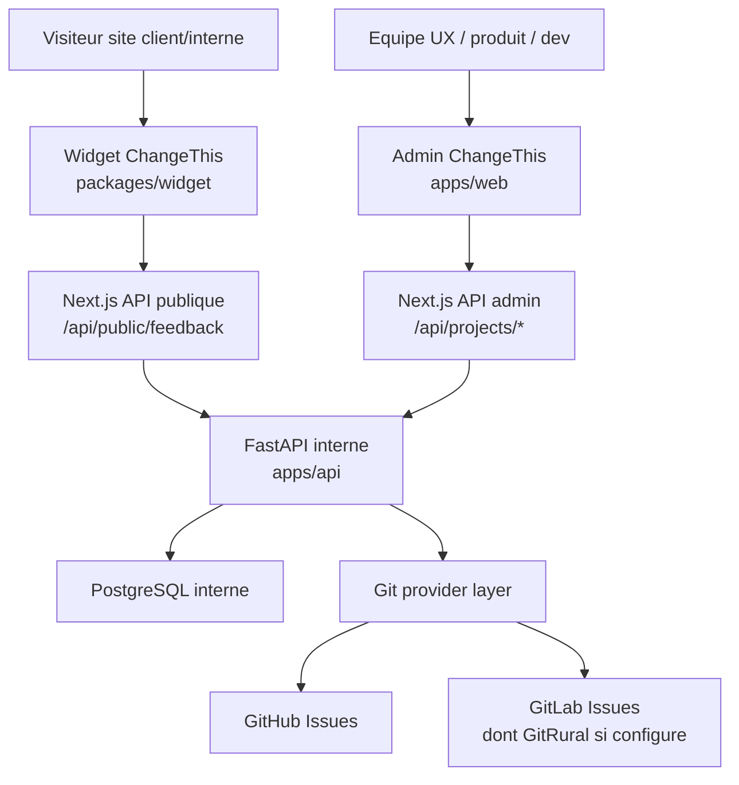
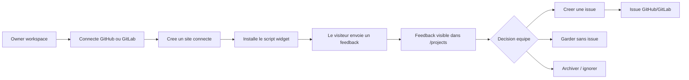
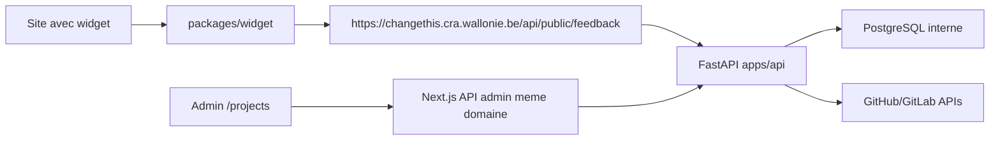
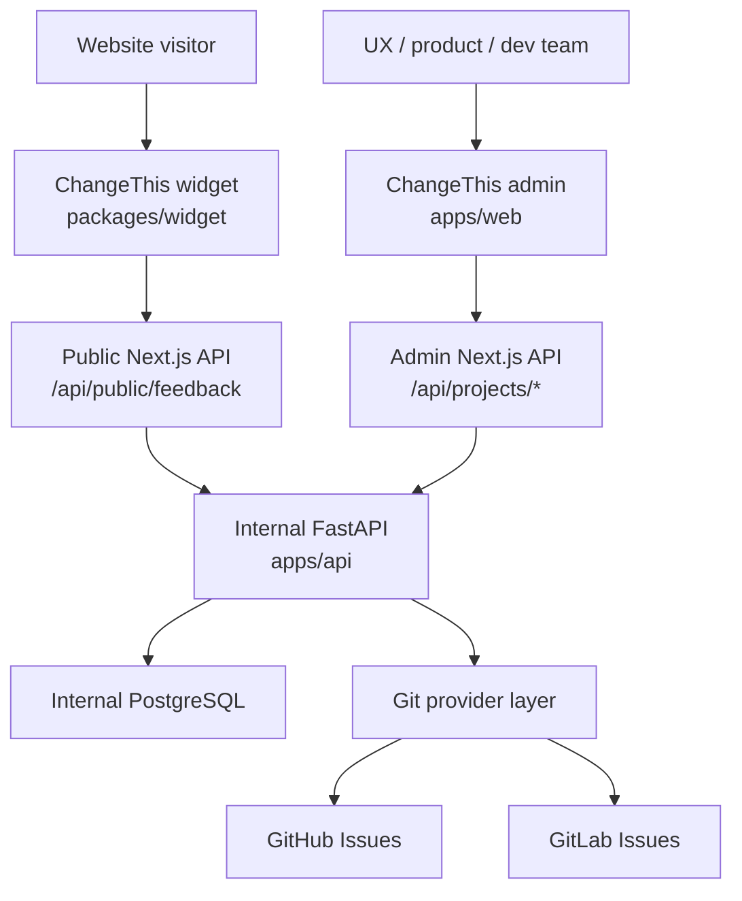
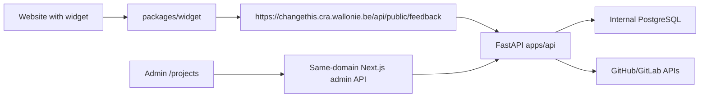

# ChangeThis

[English](#english-version)

ChangeThis est un outil interne CRA pour collecter, trier et transformer des retours visuels en issues GitHub ou GitLab. Un visiteur d'un site en conception, developpement ou recette peut laisser un commentaire, poser un repere sur la page ou envoyer une capture. L'equipe retrouve ensuite le feedback dans l'admin ChangeThis, le qualifie et decide de creer une issue dans le depot cible.

La cible documentee par `main` est l'installation interne:

- URL admin et widget: `https://changethis.cra.wallonie.be`.
- Frontend: Next.js dans `apps/web`, expose par le domaine applicatif.
- Backend interne: FastAPI dans `apps/api`, sur le meme serveur applicatif que le front.
- Base: PostgreSQL interne, seule charge attendue sur `back-tool-prod`.
- Deploiement: services natifs Ubuntu 24 via `systemd`.

Les anciens guides Railway/Supabase lies a une experimentation SaaS sont conserves uniquement dans `docs/archive/`; ils ne decrivent plus la cible active de cette branche.

## Architecture globale



## User Flow



## Data Flow



Le navigateur parle toujours au meme domaine applicatif. Next.js sert l'admin, le widget et les routes browser-facing; les appels internes partent ensuite vers FastAPI via `INTERNAL_API_URL`.

## Monorepo

- `apps/web`: application Next.js, admin, routes API navigateur, authentification, parametres et hebergement du widget.
- `apps/api`: backend FastAPI interne, SQLAlchemy, Alembic et acces PostgreSQL.
- `packages/widget`: widget JavaScript embarque sur les sites.
- `packages/shared`: types partages, validation des payloads et formatage des brouillons d'issues.
- `scripts/internal`: installation et deploiement natifs Ubuntu 24.
- `docs`: runbooks, architecture et guides utilisateur.

## Boucle produit

1. Un owner se connecte a ChangeThis.
2. L'equipe connecte GitHub ou GitLab.
3. L'owner cree un site dans `/settings/connected-sites`, choisit le depot cible et copie le script widget.
4. Un visiteur envoie un feedback depuis le site autorise.
5. `POST /api/public/feedback` valide la cle publique, l'origine, le payload et la taille des captures.
6. L'equipe traite le retour dans `/projects`, puis cree une issue, garde le feedback sans issue, l'archive ou relance une action provider.

## Installer un widget

Un site connecte expose un snippet de ce type:

```html
<script src="https://changethis.cra.wallonie.be/widget.js" data-project="project_public_key"></script>
```

En local, le meme widget est servi par le serveur web:

```html
<script src="http://localhost:3000/widget.js" data-project="project_public_key"></script>
```

Creer le site depuis `/settings/connected-sites` pour stocker ensemble la cle publique, l'origine autorisee et la destination Git. L'API publique refuse les requetes dont l'`Origin` ne correspond pas au site connecte.

## Developpement

```bash
npm install
npm run dev
```

L'application locale tourne sur `http://localhost:3000` par defaut. Si le port est occupe, utiliser l'URL affichee par Next.js.

Routes utiles:

- `/login`: entree de l'admin.
- `/signup`: creation de compte/workspace si le signup est ouvert.
- `/demo`: bac a sable widget local.
- `/projects`: inbox produit.
- `/settings/git-connections`: connexions GitHub/GitLab.
- `/settings/connected-sites`: configuration des sites et snippets widget.
- `/settings/users`: membres du workspace.
- `/api/health`: healthcheck simple.
- `/api/ready`: readiness de l'application exposee.

Configuration locale minimale:

```env
NEXT_PUBLIC_APP_URL=http://localhost:3000
AUTH_MODE=local
DATA_STORE=file
CHANGETHIS_DATA_DIR=.changethis-data
```

Configuration cible interne frontend:

```env
NODE_ENV=production
NEXT_PUBLIC_APP_URL=https://changethis.cra.wallonie.be
AUTH_MODE=internal
DATA_STORE=internal
INTERNAL_API_URL=http://127.0.0.1:8000
CHANGETHIS_SECRET_KEY=...
```

Le backend FastAPI utilise son propre fichier d'environnement avec `DATABASE_URL`, `SESSION_SECRET`, `CHANGETHIS_SECRET_KEY` et `ALLOWED_PUBLIC_ORIGINS`. Voir [docs/internal-ubuntu24-install.fr.md](docs/internal-ubuntu24-install.fr.md).

## Validation

```bash
npm run build --workspace @changethis/shared
npm run build --workspace @changethis/widget
npm run typecheck --workspace @changethis/web
npm run lint --workspace @changethis/web
npm run test --workspace @changethis/web
npm run build --workspace @changethis/web
```

Checks racine utiles:

```bash
npm run typecheck
npm run lint
npm test
npm run env:check
npm run build
```

## Etat et docs

- [docs/current-state.fr.md](docs/current-state.fr.md): source courte de l'etat courant.
- [docs/architecture.md](docs/architecture.md): architecture interne cible.
- [docs/internal-ubuntu24-install.fr.md](docs/internal-ubuntu24-install.fr.md): runbook Ubuntu 24.
- [docs/README.md](docs/README.md): index des documents actifs et archives.

## Licence

ChangeThis est distribue sous European Union Public Licence 1.2 (`EUPL-1.2`).

Voir `LICENSE.md`, `NOTICE.md` et les fichiers de licence des packages pour les details. Les dependances tierces conservent leurs propres licences.

## English Version

ChangeThis is an internal CRA feedback tool for collecting visual website feedback and turning it into GitHub or GitLab issues. Visitors can leave a note, pin something on the page, or send a screenshot. The team reviews the feedback in the ChangeThis admin, triages it, and decides whether to create an issue.

The active target documented by `main` is the internal installation:

- Admin and widget URL: `https://changethis.cra.wallonie.be`.
- Frontend: Next.js in `apps/web`.
- Internal backend: FastAPI in `apps/api`, on the same application server as the frontend.
- Database: internal PostgreSQL, the only expected workload on `back-tool-prod`.
- Deployment: native Ubuntu 24 `systemd` services.

Older Railway/Supabase SaaS experiment documents are kept only under `docs/archive/`; they are not the active target for this branch.

### Global Architecture



### Data Flow



The browser always talks to the same public domain. Next.js serves the admin, widget, and browser-facing API routes; server-side calls then reach FastAPI through `INTERNAL_API_URL`.

### Repository Structure

```txt
apps/web             Next.js admin, auth, settings, widget host, browser-facing API routes
apps/api             FastAPI backend for the internal Ubuntu/PostgreSQL target
packages/widget     Embeddable browser widget
packages/shared     Shared feedback types and issue formatting
scripts/internal    Native Ubuntu 24 install and deploy scripts
docs                 Product and technical documentation
```

### Internal Production Environment

```env
NODE_ENV=production
NEXT_PUBLIC_APP_URL=https://changethis.cra.wallonie.be
AUTH_MODE=internal
DATA_STORE=internal
INTERNAL_API_URL=http://127.0.0.1:8000
CHANGETHIS_SECRET_KEY=...
```

See [docs/internal-ubuntu24-install.fr.md](docs/internal-ubuntu24-install.fr.md) for the full runbook.
