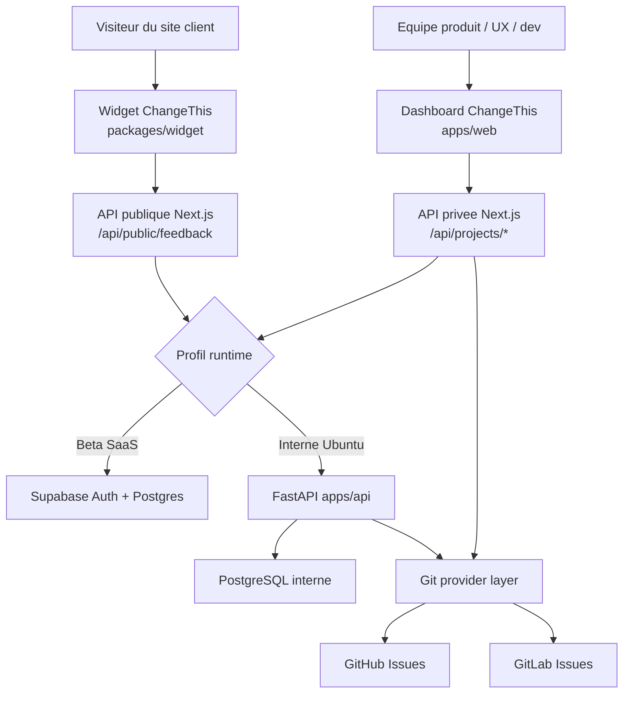
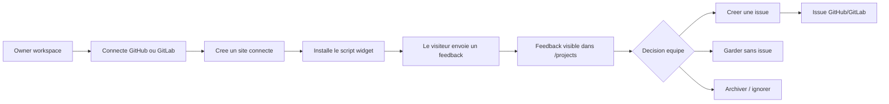
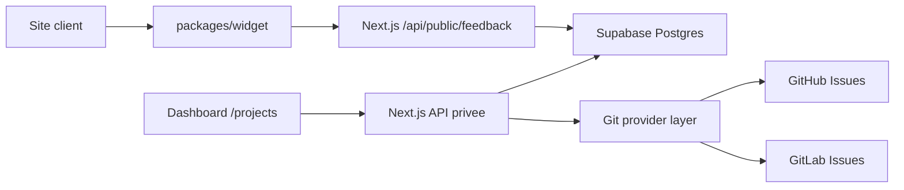
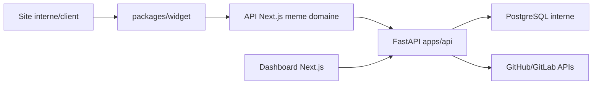
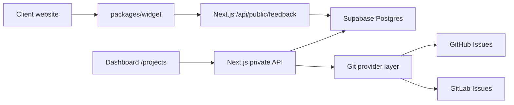
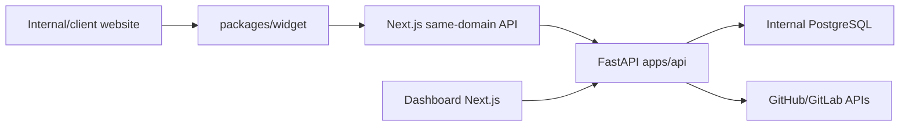

# ChangeThis

[English](#english-version)

ChangeThis est un widget de feedback et une boîte de réception produit pour les sites web en cours de conception, développement ou recette client. Un visiteur peut signaler un problème sans compte: il ajoute une note, pose un repère sur la page ou envoie une capture. L'équipe reçoit un feedback contextualisé, le trie dans l'interface ChangeThis, puis décide de créer une issue GitHub ou GitLab.

Le projet est un monorepo qui contient:

- `apps/web`: l'application Next.js, les routes API publiques, le dashboard, l'authentification, les paramètres et l'hébergement du widget.
- `packages/widget`: le widget JavaScript embarqué sur les sites clients.
- `packages/shared`: les types partagés, la validation des payloads et le formatage des brouillons d'issues.
- `apps/api`: le backend FastAPI introduit pour l'installation interne Ubuntu/PostgreSQL.

La beta SaaS actuelle tourne principalement avec Next.js + Supabase. La cible interne Ubuntu 24 introduit progressivement FastAPI + PostgreSQL, tout en gardant Next.js comme application publique et BFF sur le même domaine.

## Architecture globale



## User Flow



## Data Flow

### Beta SaaS actuelle



### Cible interne Ubuntu



Le chemin interne n'est pas encore equivalent fonctionnellement au chemin beta SaaS: `apps/api` fournit le schema et les endpoints de base, tandis que les repositories Next.js existants doivent encore migrer progressivement depuis Supabase/fichier vers le client serveur FastAPI.

## English Version

ChangeThis is a client feedback widget and product inbox for websites in development. Visitors can send feedback without creating an account; the product team signs in to triage those returns and turn them into GitHub or GitLab issues.

Clients click a fixed feedback button, add a note, pin one or more page elements, or send a screenshot. ChangeThis stores the context, keeps a durable inbox, and creates a provider-neutral issue draft with URL, viewport, browser details, pins, screenshot metadata, and labels ready for triage.

## What This Repository Contains

ChangeThis is a monorepo with four main parts:

- `apps/web`: the Next.js application, public API routes, dashboard, auth screens, settings and widget host.
- `apps/api`: the FastAPI backend foundation for the internal Ubuntu/PostgreSQL installation path.
- `packages/widget`: the embeddable browser widget loaded by client websites.
- `packages/shared`: shared feedback types, payload validation and issue formatting.

The current SaaS beta runs mostly through Next.js + Supabase. The internal Ubuntu path introduces FastAPI + PostgreSQL progressively, while keeping Next.js as the public same-domain app/BFF.

## Product Direction

- **Audience:** freelancers, small web agencies, studios, and product/design teams shipping client websites.
- **Model:** open source under the European Union Public Licence 1.2, with hosted operations and support offered by ChangeThis.
- **Promise:** clients point at what needs changing; teams receive actionable feedback, decide whether to create an issue, and keep a traceable history.
- **Current beta posture:** controlled open beta, Railway app hosting, Supabase Auth/DB for the SaaS path, OVH DNS for `app.changethis.dev`.
- **Internal path:** Ubuntu 24 native install with Next.js, FastAPI and PostgreSQL is being introduced for `changethis.toolprod`.

See [docs/current-state.fr.md](docs/current-state.fr.md) for the synchronized current-state snapshot used by the documentation.

## Current Product Loop

1. A workspace owner signs in or creates an account when public signup is enabled for the environment.
2. The team connects GitHub and/or GitLab with a server-side token, OAuth flow, or GitHub App setup.
3. The owner adds a connected site in `/settings/connected-sites`, chooses a provider, selects a real accessible repository, and copies the generated widget script.
4. A visitor submits feedback from the widget. No visitor account is required.
5. `POST /api/public/feedback` validates the public project key, allowed origin, payload, and screenshot size, then stores the feedback under the site workspace.
6. The team reviews feedback in `/projects`, filters it, creates an issue, keeps it without an issue, archives it, retries provider failures, or checks whether the external issue has been closed.

## Runtime Profiles

| Profile | Usage | Auth | Store | Domain |
|---|---|---|---|---|
| Local | Product/front-end development | `AUTH_MODE=local` | `DATA_STORE=file` | `http://127.0.0.1:3000` |
| SaaS beta | Current product path | `AUTH_MODE=supabase` | `DATA_STORE=supabase` | `https://app.changethis.dev` |
| Internal Ubuntu | Toolprod target in progress | `AUTH_MODE=internal` | `DATA_STORE=internal` | `https://changethis.toolprod` |

## Data Flow

### Current SaaS Beta



### Internal Ubuntu Target



The internal path is not yet feature-equivalent with the SaaS beta path: `apps/api` provides the schema and endpoint foundation, while the existing Next.js repositories still need to migrate progressively from Supabase/file storage to the FastAPI server client.

## Implemented Features

- Public embeddable widget served from `/widget.js` and `/widget.global.js`.
- Feedback modes: note, pin, multiple pins, capture/screenshot.
- Per-pin feedback text and sent/unsent feedback management in the widget panel.
- Public feedback API with origin validation and local rate limiting. The local limiter is a known beta hardening item for multi-instance deployments.
- Supabase-backed repositories for the real beta SaaS path: feedbacks, status events, connected sites, public keys, provider integrations, encrypted provider credentials, attempts, and external issues.
- FastAPI internal backend foundation in `apps/api` for the Ubuntu/PostgreSQL path.
- File-backed stores kept for local development with `DATA_STORE=file`.
- Dashboard inbox with filters by text, status, site, feedback type, and provider.
- Feedback actions: create issue, retry, keep without issue, archive, cancel submitted public feedback, and sync external issue state.
- Feedback statuses: `raw`, `issue_creation_pending`, `retrying`, `sent_to_provider`, `failed`, `kept`, `resolved`, `ignored`.
- Real connected-site flow: choose GitHub/GitLab, list repositories from the configured token, generate a site public key, copy the install snippet, test script installation, and delete the site.
- GitHub/GitLab provider badges and repository listing.
- GitHub/GitLab issue creation with idempotency keys and retry state.
- GitHub/GitLab issue lookup to move feedback to `resolved` when the external issue is closed.
- Git connection disable/reactivate flow.
- Supabase/local authentication modes, `/login`, `/signup`, `/logout`, auth callback cookies, protected dashboard routes, workspace roles, and a `/settings/users` members view. Production beta must use `AUTH_MODE=supabase`.
- Sonner toasts for user feedback.
- Production readiness endpoints: `/api/health` and `/api/ready`.

## Install A Widget

A connected site exposes a snippet like:

```html
<script src="https://app.changethis.dev/widget.js" data-project="project_public_key"></script>
```

In local development, the app serves the same widget route from the web server:

```html
<script src="http://localhost:3000/widget.js" data-project="project_public_key"></script>
```

Create the site from `/settings/connected-sites` so the public key, allowed site URL, and Git issue destination are stored together. The public feedback API only accepts requests whose `Origin` matches the connected site URL.

For a quick local smoke test, use `/demo`; it loads the real widget bundle and sends feedback to the current app API. A production/beta validation should use a real connected site and the script test in `/settings/connected-sites`.

## License

ChangeThis is licensed under the European Union Public Licence, version 1.2 (`EUPL-1.2`).

See `LICENSE.md`, `NOTICE.md`, and the package-level license files for details. Third-party dependencies remain under their own licenses.

## Development

```bash
npm install
npm run dev
```

The local web app runs on `http://localhost:3000` by default. If the port is occupied, Next.js may choose another port; use the URL printed by the dev server.

Useful local routes:

- `/` landing page with product CTAs.
- `/signup` account/workspace creation entry point, gated by `ENABLE_PUBLIC_SIGNUP`.
- `/api/cron/storage-cleanup` protected weekly cleanup for screenshot lifecycle (`Authorization: Bearer $CHANGETHIS_CRON_SECRET`).
- `/login` authenticated console entry point.
- `/demo` widget sandbox page that loads the real widget bundle against the current API.
- `/projects` designer/product inbox.
- `/settings/git-connections` GitHub/GitLab connection state.
- `/settings/connected-sites` real connected-site setup and widget script management.
- `/settings/users` workspace members view.
- `/api/widget/config?project=project_public_key` public widget configuration, including per-site reporter fields.
- `/api/public/feedback` public feedback ingestion.
- `/api/public/feedback/:id/cancel` public cancellation endpoint used by the widget.
- `/api/projects/sites` connected-site API.
- `/api/projects/sites/:projectKey/script-test` script installation check.
- `/api/projects/feedbacks/:id/issue` manual issue creation endpoint.
- `/api/projects/feedbacks/:id/keep` keep feedback without creating an issue.
- `/api/projects/feedbacks/:id/sync` sync external issue state.
- `/api/projects/retries` retry processor endpoint.

To test the widget end-to-end locally:

```bash
npm run widget:build
npm run dev
```

Then open `http://localhost:3000/demo` and use the floating Feedback button. For beta/prod validation, create a connected site and test the generated snippet on the target origin.

## Local Configuration

Minimum useful `.env.local` for local development:

```env
NEXT_PUBLIC_APP_URL=http://localhost:3000
AUTH_MODE=local
DATA_STORE=file
CHANGETHIS_DATA_DIR=.changethis-data
```

To list repositories and create external issues from `/projects`, add provider tokens:

```env
GITHUB_TOKEN=github_pat_or_classic_token
# or
CHANGETHIS_GITHUB_TOKEN=github_pat_or_classic_token

GITLAB_TOKEN=gitlab_personal_access_token
# or
CHANGETHIS_GITLAB_TOKEN=gitlab_personal_access_token
GITLAB_BASE_URL=https://gitlab.com
```

For GitLab, prefer a Personal Access Token with the `api` scope so ChangeThis can list every project the GitLab user can access and create issues in the selected project. For a self-hosted GitLab, set `GITLAB_BASE_URL` to the instance base URL, for example `https://gitrural.cra.wallonie.be`. A project-scoped token still works as a fallback when you paste the exact project URL in the connected-site form.

For the real beta path, use Supabase:

```env
AUTH_MODE=supabase
DATA_STORE=supabase
NEXT_PUBLIC_SUPABASE_URL=...
NEXT_PUBLIC_SUPABASE_ANON_KEY=...
SUPABASE_SERVICE_ROLE_KEY=...
CHANGETHIS_SECRET_KEY=...
```

`AUTH_MODE=local` and `DATA_STORE=file` are disabled/no-go for production beta. Railway PostgreSQL native `DATABASE_URL` is not consumed by the current code path.

For the internal Ubuntu path, use:

```env
AUTH_MODE=internal
DATA_STORE=internal
NEXT_PUBLIC_APP_URL=https://changethis.toolprod
INTERNAL_API_URL=http://back.toolprod:8000
CHANGETHIS_SECRET_KEY=...
```

The FastAPI service has its own backend environment with `DATABASE_URL`, `SESSION_SECRET`, `CHANGETHIS_SECRET_KEY`, and `ALLOWED_PUBLIC_ORIGINS`. See `docs/internal-ubuntu24-install.fr.md`.

## Validation

```bash
npm run build --workspace @changethis/shared
npm run build --workspace @changethis/widget
npm run typecheck --workspace @changethis/web
npm run lint --workspace @changethis/web
npm run test --workspace @changethis/web
npm run migrations:check
npm run prod:check
npm run build --workspace @changethis/web
```

Root-level equivalents are available:

```bash
npm run typecheck
npm run lint
npm run test
npm run migrations:check
npm run prod:check
npm run build:prod
npm run build
```

## Frontend Dependency Policy

To keep the workspace stable, maintain compatibility between Next.js and React before upgrading packages.

- Do not use `npm audit fix --force` in this repository because it can introduce breaking major changes.
- Prefer targeted upgrades, for example `npm install -w apps/web next@latest`, and validate with a web build before committing.
- Keep the baseline workflow: small iterations, one problem at a time, and `npm run build --workspace @changethis/web` as the final gate for frontend dependency changes.

## Repository Structure

```txt
apps/web             Next.js dashboard, landing page, auth, settings, and API routes
apps/api             FastAPI backend for the internal Ubuntu/PostgreSQL path
packages/widget     Embeddable browser widget
packages/shared     Shared feedback types and provider-neutral issue formatting
supabase/migrations Database schema and status migrations
docs                 Product and technical specs
```

## Known Follow-ups

- Migrate Next.js `middleware.ts` to the newer `proxy.ts` convention.
- Move local rate limiting to a shared store for serverless production.
- Sign OAuth state with a server secret before relying on provider OAuth in production.
- Store screenshots in object storage with short-lived signed URLs instead of JSON data URLs.
- Strengthen provider idempotence/locking and durable retry processing.
