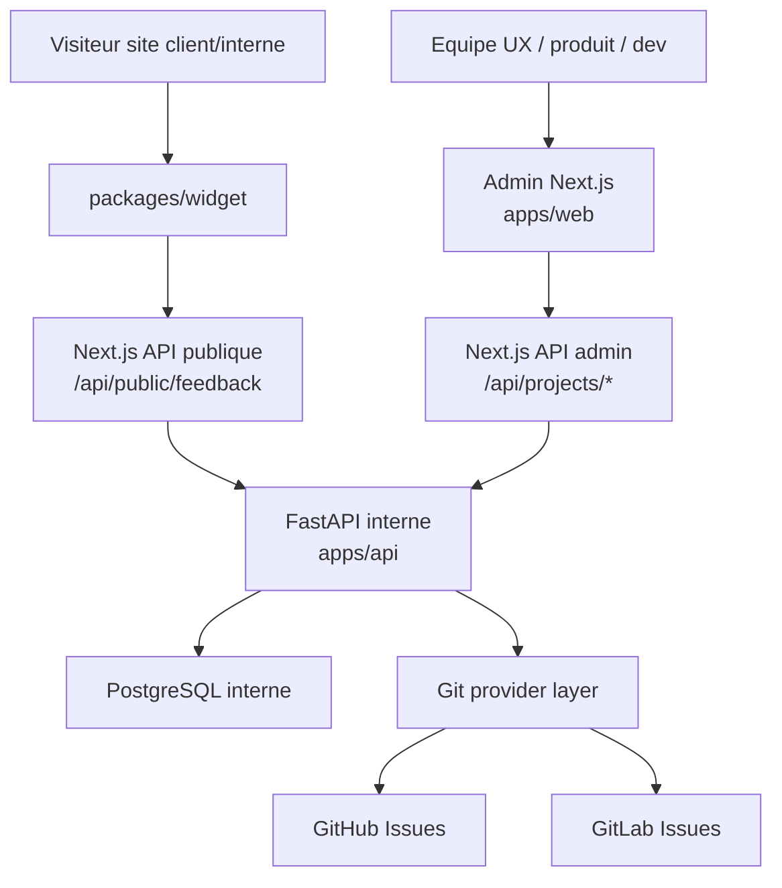
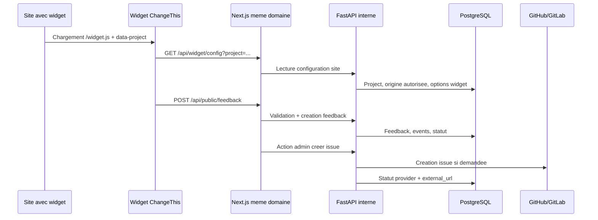

# Architecture

Etat actuel: voir [current-state.fr.md](current-state.fr.md). Ce document decrit l'architecture active de l'installation interne CRA au 2026-05-21.

## Monorepo

- `apps/web`: application Next.js App Router, admin, routes API navigateur et host du widget.
- `apps/api`: backend FastAPI interne, PostgreSQL, SQLAlchemy et Alembic.
- `packages/widget`: widget public charge par les sites clients ou internes.
- `packages/shared`: types et validation de payload partages entre app et widget.
- `scripts/internal`: installation native Ubuntu 24 et deploy `systemd`.
- `docs/archive`: documents historiques, non actifs pour l'installation interne.

## Profil de runtime actif

| Profil | Usage | Auth | Store | Domaine |
|---|---|---|---|---|
| Local | Dev produit/front | `AUTH_MODE=local` | `DATA_STORE=file` | `http://127.0.0.1:3000` |
| Interne CRA | Installation cible | `AUTH_MODE=internal` | `DATA_STORE=internal` | `https://changethis.cra.wallonie.be` |

## Flux global

## Dataflow feedback

## Frontend et BFF

Le navigateur doit continuer a parler au meme domaine applicatif:

- `https://changethis.cra.wallonie.be/widget.js`
- `https://changethis.cra.wallonie.be/api/public/feedback`
- `https://changethis.cra.wallonie.be/api/projects/...`

Cette contrainte evite de complexifier CORS cote navigateur. Next.js reste la couche publique/BFF et dialogue avec FastAPI via `INTERNAL_API_URL`.

## Donnees et securite

- La cle projet du widget est publique; l'origine HTTP reste validee cote API.
- Les tokens provider GitHub/GitLab ne doivent jamais entrer dans le navigateur.
- Les credentials provider sont chiffres applicativement et stockes cote backend.
- Les screenshots restent une dette connue: data URL aujourd'hui, stockage objet interne a brancher.
- `/api/ready` doit rester le check operationnel principal de l'app exposee.
- Les modes non supportes (`AUTH_MODE=ovh`, `DATA_STORE=postgres`) ne doivent plus etre documentes comme deployables.

## Deploiement interne

- `front-tool-prod` / `frontend.toolprod`: services `changethis-web.service` et `changethis-api.service`, Next.js sur `127.0.0.1:3000` et FastAPI sur `127.0.0.1:8000`.
- `back-tool-prod` / `back.toolprod`: PostgreSQL interne uniquement.
- Domaine utilisateur: `https://changethis.cra.wallonie.be`.
- Vhost frontal: reverse proxy vers Next.js.
- Secrets: `/etc/changethis/web.env` et `/etc/changethis/api.env`, lisibles uniquement par l'utilisateur applicatif.
