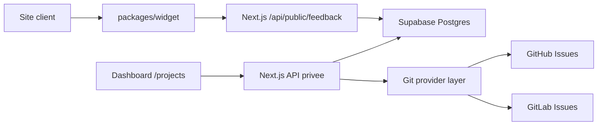
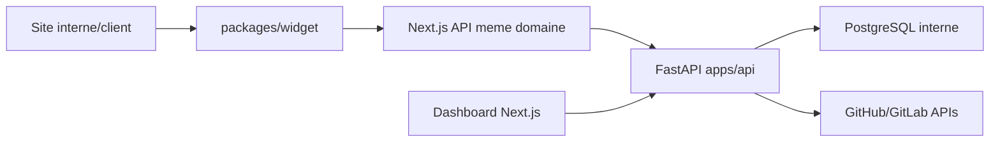

# Architecture

Etat actuel: voir [current-state.fr.md](current-state.fr.md). Ce document decrit l'architecture effective et les deux profils de deploiement supportes au 2026-05-21.

## Monorepo

- `apps/web`: application Next.js App Router, dashboard, routes API navigateur et host du widget.
- `apps/api`: backend FastAPI interne, PostgreSQL, SQLAlchemy et Alembic.
- `packages/widget`: widget public charge par les sites clients.
- `packages/shared`: types et validation de payload partages entre app et widget.
- `supabase/migrations`: schema du chemin beta SaaS Supabase.
- `scripts/internal`: installation native Ubuntu 24 et deploy `systemd`.

## Profils de runtime

| Profil | Usage | Auth | Store | Domaine |
|---|---|---|---|---|
| Local | Dev produit/front | `AUTH_MODE=local` | `DATA_STORE=file` | `http://127.0.0.1:3000` |
| Beta SaaS | Chemin produit actuel | `AUTH_MODE=supabase` | `DATA_STORE=supabase` | `https://app.changethis.dev` |
| Interne Ubuntu | Cible Toolprod en amorcage | `AUTH_MODE=internal` | `DATA_STORE=internal` | `https://changethis.toolprod` |

## Flux beta SaaS actuel

## Flux interne cible

Etat reel du flux interne: `apps/api` expose les endpoints et le schema de base; le dashboard Next.js doit encore migrer ses repositories depuis Supabase/fichier vers un client serveur FastAPI.

## Frontend et BFF

Le navigateur doit continuer a parler au meme domaine applicatif:

- beta SaaS: `https://app.changethis.dev/api/...`
- interne: `https://changethis.toolprod/api/...`

Cette contrainte evite de complexifier CORS cote navigateur. En cible interne, Next.js reste la couche publique/BFF et dialogue avec FastAPI via `INTERNAL_API_URL`.

## Donnees et securite

- La cle projet du widget est publique; l'origine HTTP reste validee cote API.
- Les tokens provider GitHub/GitLab ne doivent jamais entrer dans le navigateur.
- Les credentials provider sont chiffres applicativement dans le chemin Supabase actuel.
- Les screenshots restent une dette connue: data URL aujourd'hui, stockage objet a brancher.
- `/api/ready` doit rester le check operationnel principal de l'app exposee.
- Les modes non supportes (`AUTH_MODE=ovh`, `DATA_STORE=postgres`) ne doivent plus etre documentes comme deployables.
